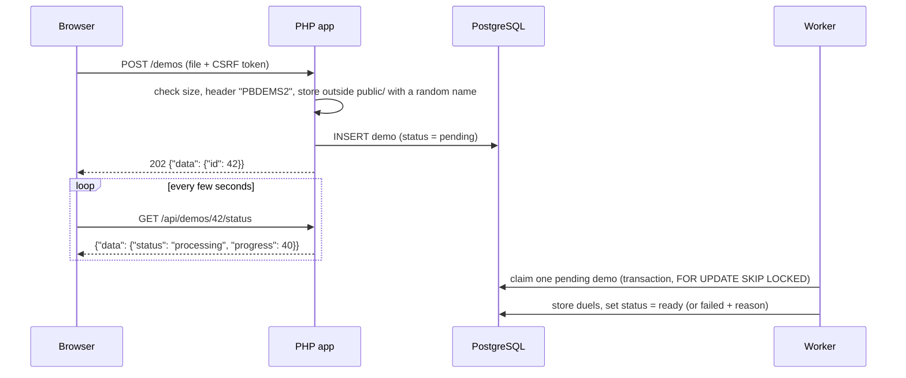

# DuelLab: architecture

Status: target design, last updated 2026-11-13 (end of M1). Parts not in the repository yet are marked *(planned)*.
This file records decisions and their reasons. Coding rules are in the `AGENTS.md` files.

## Why it looks like this

- The course forbids frameworks, so routing, sessions, CSRF, views and translations are our own code.
- The author explains every line at the demo, so simple beats clever.
- The demo parser is the author's own existing code, run as a separate service.

Undecided technical points are listed at the end of this file, in Open technical questions.

## Components

| Service (`docker-compose.yaml`) | Role                                                  | Host port | Status    |
|---------------------------------|-------------------------------------------------------|-----------|-----------|
| `server` (nginx)                | serves `public/`, passes `.php` requests to `php:9000` | 8080      | exists    |
| `php` (PHP 8.3 FPM)             | the web application                                   | —         | exists    |
| `db` (PostgreSQL 17)            | data                                                  | 5433      | exists; data persists in the `pg-data` volume |
| `mailpit`                       | catches e-mail locally; SMTP at `mailpit:1025`        | 8025 (UI) | exists    |
| `pgadmin-wdpai`                 | database browser, development only                    | 5050      | exists    |
| worker                          | demo parser, separate container                       | —         | (planned) |
| cron                            | scheduled jobs                                        | —         | (planned) |

Services talk over the `pg-network` network by service name, so the app reaches the database at `db:5432`, not
`localhost:5433`. Variables and ports are listed in `.env.example`.

### Database connection

- `php` receives an explicit list of variables (`DB_HOST`, `DB_PORT`, `DB_NAME`, `DB_USER`, `DB_PASSWORD`), not the whole `.env`,
  so it never sees secrets of other services (least privilege). Host and port are fixed in compose: they are the Docker network
  address, not secrets.
- The app reads them with `getenv()`, not `$_ENV`: `$_ENV` stays empty when `variables_order` lacks `E` (as in `php.ini-production`).
  PHP-FPM passes the container environment because the official image sets `clear_env = no`. A missing or empty variable
  fails at startup with its name, never its value.
- One `PDO` per request, created eagerly in `public/index.php` and passed down by hand (no singleton). One connection per request
  is cheap at this scale; lazy creation would add complexity for no measurable gain.
- Options: `ERRMODE_EXCEPTION`, `FETCH_ASSOC`, `EMULATE_PREPARES => false` (real server-side prepared statements).
- A `PDOException` while connecting is logged with `error_log()` and replaced by `ConnectionFailed` without `previous`, so the DSN
  never reaches the page. `public/index.php` maps it to 503 (`ServiceUnavailable`): the outage is temporary and on a dependency's side.
  The database layer itself does not know about HTTP.

### Session

- Started on every request by `App\Http\Session::start()` in `public/index.php`, before the database and before any output
  (the cookie is a header). Starting it only on pages that need it would save little at this scale and adds a rule to remember.
- Cookie `duellab_session`, lifetime 0 (ends with the browser), `HttpOnly`, `SameSite=Lax`; `use_strict_mode` rejects ids
  the server never issued (session fixation). PHP also sends `Cache-Control: no-store`, so pages are not cached.
- `Secure` comes from `SESSION_SECURE` (`0`/`1`, compose default `0`), not from detecting HTTPS: behind a proxy `$_SERVER['HTTPS']`
  is unreliable. Any other value fails at startup, so a typo never silently drops `Secure` in production.
- The session holds only the user id (from login on) and the CSRF token. Name and role are read from the database on every request,
  so a role change takes effect immediately (lab 9 keeps more in the session; this is a deliberate difference).
- `Session` wraps `$_SESSION` by reference, so unit tests pass a plain array and need no real session.

### CSRF

- Synchronizer token: one random token per session (`bin2hex(random_bytes(32))`), created by `Csrf::ensureToken()` at the start of every
  request in `public/index.php` (before the check, so the 403 page can render) and stored in the session. `Csrf::token()` only reads
  and throws if the token is missing (command–query separation), so `render()` never writes to the session.
  Another site cannot read it (same-origin policy), so it cannot put it into a forged form. `SameSite=Lax` is the first layer, the token the second.
  One token per session, not per form: per-form tokens break the back button and several open tabs. It rotates after login.
- Checked once for every POST in `public/index.php`, right after the session starts and before the database and dispatch
  (`Csrf::verifyRequest()`): "every POST" has no exceptions, and a check inside each action is easy to forget.
  A missing, empty, non-string or wrong token → `Forbidden` (403 page). Compared with `hash_equals()` (constant time), never `===`.
- Templates get the token as `$csrfToken` from `AppController::render()`, next to `$e`, and print it only through
  `partials/csrf-field.html.php`. This is a deliberate hidden dependency on the session in the base controller: every POST form
  on every page needs the token, including the error page (logout form in the header), and injecting it into every controller would
  add a constructor and a factory per controller with no new behaviour. Frameworks do the same (Laravel `@csrf`, Twig `csrf_token()`).
- Consequences: a POST to an unknown URL without a token is 403, not 404. An upload larger than `post_max_size` empties `$_POST`,
  so it ends as 403 instead of "file too large"; the upload step (M4) has to handle that.
- `/api/*` (M3): the token goes in the `X-CSRF-Token` header instead of a form field.

### Login

- `GET /login` and `POST /login` are two actions (`login()`, `authenticate()`), not one action branching on the method as in lab 9:
  the router already tells GET from POST, and each action keeps one responsibility.
- Wrong credentials re-render the form with status 422, one generic message and the e-mail kept; no redirect. Post/Redirect/Get
  protects a POST that changed something, and a failed login changed nothing. 422 makes the failure visible to curl;
  401 would require a `WWW-Authenticate` header, which a form login has no use for.
- Input limits: an e-mail over 254 characters or a password over 72 bytes fails with the same generic message, before any query.
  bcrypt reads only the first 72 bytes, so a longer password with the right prefix would otherwise pass.
- On success, in this order: `session_regenerate_id(true)` (an id known before login becomes useless: session fixation),
  `user_id` into the session, a new CSRF token (the guest's token stops working), then 303 to `/demos`.
- `password_needs_rehash()` is deferred: PHP 8.3 defaults to bcrypt cost 10, the cost of the seeded hashes, so the branch could
  never run. Add it, with a repository method that stores the new hash, when moving to PHP 8.4 (default cost 12).
- Logout is a POST with the CSRF token (a GET link could be triggered by any `` on another site). `Session::destroy()` empties
  the data, expires the cookie with the parameters it was set with (a cookie only matches when path and domain match) and calls
  `session_destroy()`, which deletes the server-side file, so a copied old id no longer works. Then 303 to `/login`.
  The `time() - 3600` passed to `setcookie()` never reaches the browser: for an empty value PHP sends
  `deleted; expires=Thu, 01 Jan 1970 00:00:01 GMT; Max-Age=0` itself. `Max-Age=0` does not depend on the client's clock
  and wins over `Expires` (RFC 6265, 5.3). We keep the php.net idiom on purpose; any past date would do.

## Layers

```
public/index.php → src/Routing.php → controller → service → repository interface → PDO → PostgreSQL
                                          ↓
                                   public/views (presentation only)
```

- Routing runs guards (logged in, role) before the controller; the CSRF check runs earlier, in `public/index.php`.
- Services hold business logic: today `AuthService` (login check); planned: upload checks, diagnosis, scenario generation,
  `.cfg` export, e-mail.
- Repositories are the only place with SQL, each behind an interface (today `UserRepository` → `PdoUserRepository`).
  Services depend on the interface, so unit tests swap in an in-memory double and need no database.
  Rows are mapped to `readonly` models by hand, which keeps types explicit and works with `readonly` (unlike `FETCH_CLASS`).
- Objects are wired by hand in `public/index.php`. No DI container, because it is easier to explain at the demo.
  A controller with collaborators is registered with a factory closure (`fn () => new SecurityController($authService, $session, $csrf)`),
  which the router calls only for the matched route, so unrelated controllers are never built. The alternative, `new` inside
  the controller, hides the dependency and is a service locator in practice.
  Routes are registered inside the `try` in `public/index.php`, after the services exist: an arrow function captures variables
  by value when it is created, so a factory defined earlier would capture undefined variables.
- Equal login timing (M2): for an unknown e-mail `AuthService` still runs `password_verify()` against a fixed bcrypt hash
  of the same cost. Otherwise the missing bcrypt work makes the answer measurably faster and reveals which e-mails have accounts.
- Layers for users only (M2): the other controllers keep mock data until the milestones that build their data.
- Malformed vs unknown query input (M1): a parameter that is not a string (`?map[]=x`, PHP turns it into an array)
  cannot be interpreted, so it is 400. A string outside the whitelist (`?map=foo`) falls back to the default, so an
  old or hand-edited link still opens the page. `BadRequest` is one of the `HttpException` subclasses.
- HTTP errors as exceptions (M2): an action, and later a guard or the CSRF check, stops the request by throwing
  `BadRequest`, `Forbidden` or `NotFound`; `public/index.php` catches `HttpException` once and renders the error page.
  A redirect is a thrown `Redirect` (303 See Other, local path only), because `exit` is banned and cannot be tested.
  Returning a response object instead would change every action and the router. `Unauthorized` (401) comes with the guards,
  since pages redirect to `/login` and there is no `/api/` yet.

## Request flows

Uploading a demo:



Saving a training set: `POST /api/training-sets` with JSON `{name, duelIds}` → the service checks that every duel
belongs to the user, is trainable and is on the same map (max 5) → the set and its items are inserted in one
transaction → `201` with the new id.

## Routes *(planned)*

| Method | Path | Access | Purpose |
|--------|------|--------|---------|
| GET | `/` | all | redirect to `/demos` or `/login` |
| GET, POST | `/login`, `/register` | guest | forms |
| POST | `/logout` | user | ends the session |
| GET, POST | `/password/forgot` | guest | send a reset link |
| GET, POST | `/password/reset/{token:[a-f0-9]{64}}` | guest | set a new password |
| GET | `/demos` | user | list and upload page |
| POST | `/demos` | user | upload |
| GET | `/demos/{id:\d+}` | owner | lost duels and radar |
| GET | `/api/demos/{id:\d+}/status` | owner | JSON status for polling |
| GET | `/hotspots?map=&days=&issue=&side=` | user | filtered hotspots |
| POST | `/api/training-sets` | user | JSON, create a set |
| GET | `/training-sets/{id:\d+}` | owner | the set |
| GET | `/training-sets/{id:\d+}/cfg` | owner | download `.cfg` |
| POST | `/training-sets/{id:\d+}/email` | owner | send `.cfg` by e-mail |
| POST | `/locale` | all | switch PL/EN |
| GET, POST | `/admin/maps`, `/admin/maps/{id:\d+}` | ADMIN | maps and radar upload |
| GET | `/admin/queue` | ADMIN | processing status |
| POST | `/admin/queue/{id:\d+}/retry` | ADMIN | retry a failed demo |

## Data model *(planned)*

| Table | Holds | Foreign keys (ON DELETE, reason) |
|-------|-------|----------------------------------|
| `users` *(exists)* | email, name, password hash, role (USER/ADMIN), locale, weekly-summary opt-in | — |
| `maps` *(exists)* | name, radar image path, `pos_x`, `pos_y`, `scale` | — |
| `demos` | file path, status, progress, error, played/uploaded/processed times, raw-file-deleted time | `user_id` CASCADE (a demo means nothing without its owner); `map_id` RESTRICT (a map with demos cannot disappear), NULL until parsed |
| `duels` | round, ticks, player spawn and death position, view angles, killer position, weapons, measured values, flashed, trainable | `demo_id` CASCADE (duels come from the demo) |
| `diagnosis_types` | code, severity, translation key | — |
| `duel_diagnoses` | measured value per diagnosis | `duel_id` CASCADE; `diagnosis_type_id` RESTRICT (a type in use cannot be deleted) |
| `training_sets` | name, created time | `user_id` CASCADE; `map_id` RESTRICT |
| `training_set_items` | position in the set | `training_set_id` CASCADE; `duel_id` CASCADE (a scenario without its duel is empty) |
| `password_resets` | token hash, expiry, used time | `user_id` CASCADE |
| `cron_runs` | job name, start, end, status, message | — |

- View `v_death_hotspots`: lost duels grouped by user, map and grid cell, with the most common diagnosis. It feeds the Hotspots page.
- Transactions: claiming a demo from the queue, and saving a training set with its items.

This table is the source for the graded Mermaid ERD in `README.md`, written once the schema exists.

### Migrations

- The schema is a set of numbered files `docker/db/NNN_verb_object.sql` (three digits, so name order equals number order).
  Postgres runs them as init scripts, only when the `pg-data` volume is empty.
- In development a schema change means `docker compose down -v` and a fresh start, which wipes the data. That does not work
  on a server with real data, so before the deploy (M3) we decide on a small runner (a `schema_migrations` table that records
  which files have been applied).
- E-mail uniqueness ignores case through a unique index on `LOWER(email)`, so lookups must compare `LOWER(email)` to use it.
  Role and locale are `CHECK` lists, not lookup tables: two fixed values each, which no screen edits.
- `maps.scale` only has to be positive (radar coordinates are divided by it). The 0.1–20 range belongs to the admin form.
- Demo data lives in `900_seed_demo_data.sql`; the high number keeps it after every migration. It uses `ON CONFLICT DO NOTHING`,
  so it can be re-run by hand. It contains demo accounts with a public password, so the production deploy (M3) must not
  load it as is: split maps from accounts or skip the file.

## Domain calculations

- Radar position for a 1024 px radar image: `x = (world_x − pos_x) / scale`, `y = (pos_y − world_y) / scale`; scale linearly for other sizes.
- Demos run at 64 ticks per second. The scenario spawn is the player's position and view at first contact minus 48 ticks (0.75 s); the bot stands where the killer was at first contact.
- `.cfg` placement uses `bot_place`, which puts an existing, living bot where the player's crosshair ray hits the world. Each scenario is one line: `setpos x y z+50; setang 89 0 0; bot_place; setpos <spawn>; setang <view>`, where `x y z` is the killer's position from the demo (feet, same units as `getpos`). CS2 has no `wait` command, and the line works without one: the server applies the teleport before `bot_place` traces. Requires `sv_cheats 1`, so offline or private games only.
- The `.cfg` export is deterministic: the same training set always gives a byte-identical file, so it can be tested with exact expected output.

## Scheduled jobs *(planned)*

| Job | When | What | Safe to re-run because |
|-----|------|------|------------------------|
| clean raw demos | daily | deletes `.dem` files of processed demos older than N days, keeps the parsed data | skips demos already marked as deleted |
| requeue stuck demos | every 10 min | returns demos stuck in processing to pending | only touches rows past the timeout |
| clean expired resets | daily | removes expired password-reset tokens | deleting nothing is fine |
| weekly summary | Mondays | e-mails opted-in users their top hotspots | records the send in `cron_runs`, skips users already sent this week |

Each run is logged in `cron_runs`.

## Open technical questions

- **Where diagnosis runs:** in the parser worker, or in PHP from the raw duel data the worker stores. Undecided. PHP would keep the rules unit-tested with PHPUnit and explainable at the demo.
- **`bot_place` accuracy and height offset:** checked in CS2 on de_mirage (2026-11-12): works, no correction needed. Bot feet vs target height: crate 0.1, plank on a crate 0.1, flat ground 1.5, stairs 3.7 units (the hull rests on the higher step). Horizontally the bot lands under the crosshair; the theoretical error is about 3 units, because pitch stops at 89°. Open: which way the placed bot faces. `setpos_player` and `ent_setang` exist but were not needed. `getpos` inside the same `.cfg` still prints the old position, so measure by hand afterwards.
- **Visibility data:** does the parser expose "spotted" flags or line of sight? Without them, "first contact" needs another method.
- **Writing into the CS2 folder:** Chrome may block writing to the Steam folder; the fallback is a normal download.