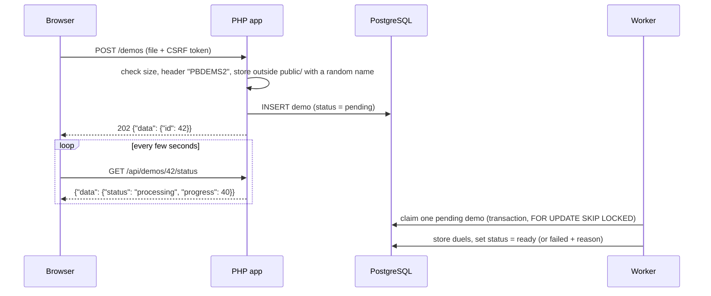

# DuelLab: architecture

Status: target design, 2026-11-01. Parts not in the repository yet are marked *(planned)*.
This file records decisions and their reasons. Coding rules are in the `AGENTS.md` files.

## Why it looks like this

- The course forbids frameworks, so routing, sessions, CSRF, views and translations are our own code.
- The author explains every line at the demo, so simple beats clever.
- The demo parser is the author's own existing code, run as a separate service.

Open questions about languages and libraries are in `roadmap.md` → Pending decisions.

## Components

| Service (`docker-compose.yaml`) | Role                                                  | Host port | Status    |
|---------------------------------|-------------------------------------------------------|-----------|-----------|
| `server` (nginx)                | serves `public/`, passes `.php` requests to `php:9000` | 8080      | exists    |
| `php` (PHP 8.3 FPM)             | the web application                                   | —         | exists    |
| `db` (PostgreSQL 17)            | data                                                  | 5433      | exists; data persists in the `pg-data` volume |
| `mailpit`                       | catches e-mail locally; SMTP at `mailpit:1025`        | 8025 (UI) | exists    |
| `pgadmin-wdpai`                 | database browser, development only                    | 5050      | exists    |
| worker                          | demo parser, separate container                       | —         | (planned) |
| cron                            | scheduled jobs                                        | —         | (planned) |

Services talk over the `pg-network` network by service name, so the app reaches the database at `db:5432`, not
`localhost:5433`. Variables and ports are listed in `.env.example`.

## Layers

```
public/index.php → src/Routing.php → controller → service → repository interface → PDO → PostgreSQL
                                          ↓
                                   public/views (presentation only)
```

- Routing runs guards (logged in, role, CSRF) before the controller.
- Services *(planned)* hold business logic: upload checks, diagnosis, scenario generation, `.cfg` export, e-mail.
- Repositories *(planned)* are the only place with SQL, each behind an interface.
- Objects are wired by hand in `public/index.php`. No DI container, because it is easier to explain at the demo.
- Malformed vs unknown query input (M1): a parameter that is not a string (`?map[]=x`, PHP turns it into an array)
  cannot be interpreted, so it is 400. A string outside the whitelist (`?map=foo`) falls back to the default, so an
  old or hand-edited link still opens the page. `BadRequest` is caught in `public/index.php`, one place for the 400 page;
  M2 generalises it to 401/403/404.

## Request flows

Uploading a demo:



Saving a training set: `POST /api/training-sets` with JSON `{name, duelIds}` → the service checks that every duel
belongs to the user, is trainable and is on the same map (max 5) → the set and its items are inserted in one
transaction → `201` with the new id.

## Routes *(planned)*

| Method | Path | Access | Purpose |
|--------|------|--------|---------|
| GET | `/` | all | redirect to `/demos` or `/login` |
| GET, POST | `/login`, `/register` | guest | forms |
| POST | `/logout` | user | ends the session |
| GET, POST | `/password/forgot` | guest | send a reset link |
| GET, POST | `/password/reset/{token:[a-f0-9]{64}}` | guest | set a new password |
| GET | `/demos` | user | list and upload page |
| POST | `/demos` | user | upload |
| GET | `/demos/{id:\d+}` | owner | lost duels and radar |
| GET | `/api/demos/{id:\d+}/status` | owner | JSON status for polling |
| GET | `/hotspots?map=&days=&issue=&side=` | user | filtered hotspots |
| POST | `/api/training-sets` | user | JSON, create a set |
| GET | `/training-sets/{id:\d+}` | owner | the set |
| GET | `/training-sets/{id:\d+}/cfg` | owner | download `.cfg` |
| POST | `/training-sets/{id:\d+}/email` | owner | send `.cfg` by e-mail |
| POST | `/locale` | all | switch PL/EN |
| GET, POST | `/admin/maps`, `/admin/maps/{id:\d+}` | ADMIN | maps and radar upload |
| GET | `/admin/queue` | ADMIN | processing status |
| POST | `/admin/queue/{id:\d+}/retry` | ADMIN | retry a failed demo |

## Data model *(planned)*

| Table | Holds | Foreign keys (ON DELETE, reason) |
|-------|-------|----------------------------------|
| `users` | email, password hash, role (USER/ADMIN), locale, weekly-summary opt-in | — |
| `maps` | name, radar image path, `pos_x`, `pos_y`, `scale` | — |
| `demos` | file path, status, progress, error, played/uploaded/processed times, raw-file-deleted time | `user_id` CASCADE (a demo means nothing without its owner); `map_id` RESTRICT (a map with demos cannot disappear), NULL until parsed |
| `duels` | round, ticks, player spawn and death position, view angles, killer position, weapons, measured values, flashed, trainable | `demo_id` CASCADE (duels come from the demo) |
| `diagnosis_types` | code, severity, translation key | — |
| `duel_diagnoses` | measured value per diagnosis | `duel_id` CASCADE; `diagnosis_type_id` RESTRICT (a type in use cannot be deleted) |
| `training_sets` | name, created time | `user_id` CASCADE; `map_id` RESTRICT |
| `training_set_items` | position in the set | `training_set_id` CASCADE; `duel_id` CASCADE (a scenario without its duel is empty) |
| `password_resets` | token hash, expiry, used time | `user_id` CASCADE |
| `cron_runs` | job name, start, end, status, message | — |

- View `v_death_hotspots`: lost duels grouped by user, map and grid cell, with the most common diagnosis. It feeds the Hotspots page.
- Transactions: claiming a demo from the queue, and saving a training set with its items.

This table is the source for the graded Mermaid ERD in `README.md`, written once the schema exists.

## Domain calculations

- Radar position for a 1024 px radar image: `x = (world_x − pos_x) / scale`, `y = (pos_y − world_y) / scale`; scale linearly for other sizes.
- Demos run at 64 ticks per second. The scenario spawn is the player's position and view at first contact minus 48 ticks (0.75 s); the bot stands where the killer was at first contact.
- `.cfg` placement uses `bot_place`, which puts an existing, living bot where the player's crosshair ray hits the world. Each scenario is one line: `setpos x y z+50; setang 89 0 0; bot_place; setpos <spawn>; setang <view>`, where `x y z` is the killer's position from the demo (feet, same units as `getpos`). CS2 has no `wait` command, and the line works without one: the server applies the teleport before `bot_place` traces. Requires `sv_cheats 1`, so offline or private games only.
- The `.cfg` export is deterministic: the same training set always gives a byte-identical file, so it can be tested with exact expected output.

## Scheduled jobs *(planned)*

| Job | When | What | Safe to re-run because |
|-----|------|------|------------------------|
| clean raw demos | daily | deletes `.dem` files of processed demos older than N days, keeps the parsed data | skips demos already marked as deleted |
| requeue stuck demos | every 10 min | returns demos stuck in processing to pending | only touches rows past the timeout |
| clean expired resets | daily | removes expired password-reset tokens | deleting nothing is fine |
| weekly summary | Mondays | e-mails opted-in users their top hotspots | records the send in `cron_runs`, skips users already sent this week |

Each run is logged in `cron_runs`.

## Open technical questions

- **Where diagnosis runs:** in the parser worker, or in PHP from the raw duel data the worker stores. Undecided. PHP would keep the rules unit-tested with PHPUnit and explainable at the demo.
- **`bot_place` accuracy and height offset:** checked in CS2 on de_mirage (2026-11-12): works, no correction needed. Bot feet vs target height: crate 0.1, plank on a crate 0.1, flat ground 1.5, stairs 3.7 units (the hull rests on the higher step). Horizontally the bot lands under the crosshair; the theoretical error is about 3 units, because pitch stops at 89°. Open: which way the placed bot faces. `setpos_player` and `ent_setang` exist but were not needed. `getpos` inside the same `.cfg` still prints the old position, so measure by hand afterwards.
- **Visibility data:** does the parser expose "spotted" flags or line of sight? Without them, "first contact" needs another method.
- **Writing into the CS2 folder:** Chrome may block writing to the Steam folder; the fallback is a normal download.